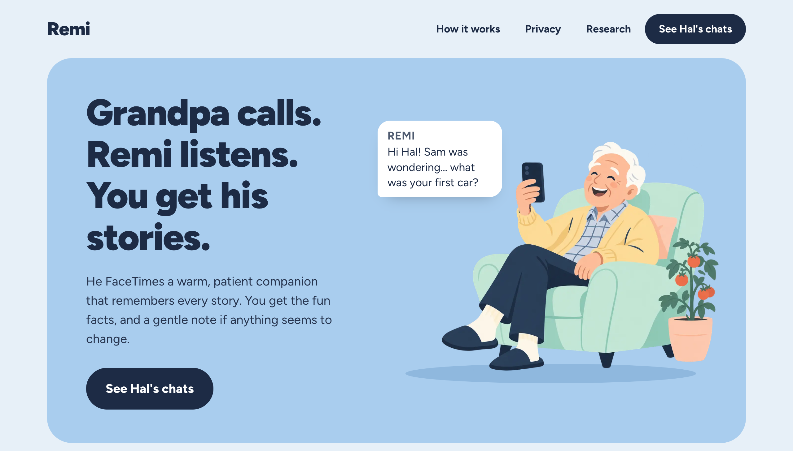
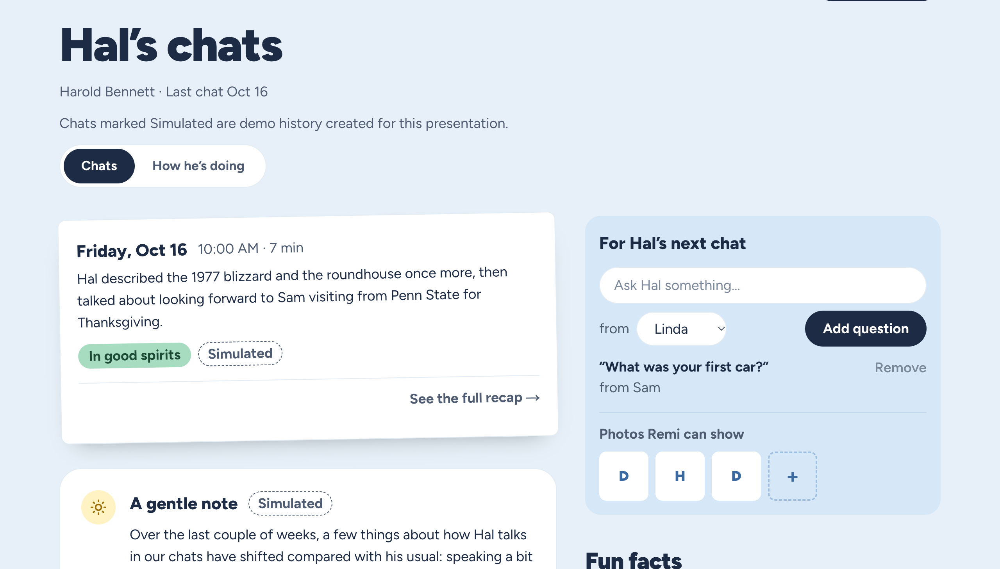
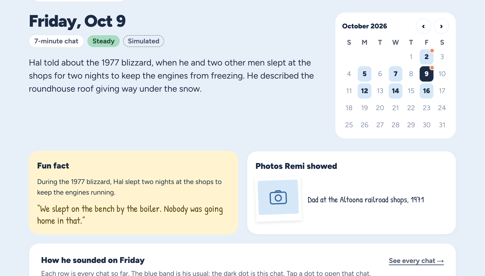
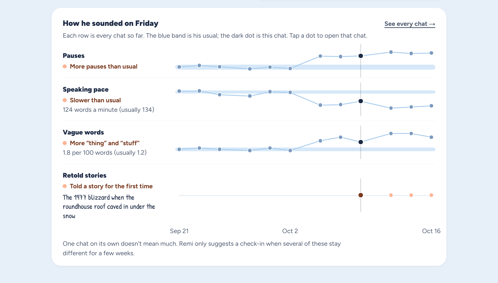

# Remi

Grandpa FaceTimes Remi whenever he likes. Remi is a patient, friendly voice that remembers his
stories, shows him family photos, and asks the questions his grandkids sent. Afterwards his family
gets the good parts: what he talked about, the fun facts, his answers. Over weeks, Remi also keeps
an eye on a few things about how he talks, compared with his own usual, and gently lets the family
know if it may be a good time to check in.

Built in 24 hours at HackPSU Fall 2026.

## Why we built it

Most older adults who live alone don't want another app, a wearable, or a test. They will pick up
a FaceTime call. We were inspired by the I-CONECT study, a randomized trial where adults over 75 had
frequent video conversations with trained interviewers, and the group with mild cognitive
impairment showed better scores after six months. Whether a conversation with an AI gives the same
benefit hasn't been tested. Remi borrows the format, a friendly chat with a theme and a photo, and
puts the family at the centre of it.

The other half is noticing. Families often only see a parent a few times a year, and small changes
in how someone talks are easy to miss. Remi compares each chat with that person's own history,
never with other people, and only speaks up when several things stay different for a few weeks.

## What the family sees

**Hal's chats.** The newest chat sits at the top, with a gentle note below it when there is one.
On the right, the family adds questions and photos for the next call. Remi asks the oldest
waiting question and shows the photos it hasn't shown in a while.

**A recap for every chat.** What they talked about, the fun fact in Hal's own words, the photos
Remi showed, and Linda or Sam's question with his answer. The small calendar jumps between chats.

**How he sounded.** Four plain signals on one timeline: pauses, speaking pace, vague words like
"thing" and "stuff", and stories told again across chats. The blue band is his usual; the dark dot
is the chat you're looking at. Everything is in words a family member can read in a few seconds.

While a call is happening, his page updates live: "Chatting now", the photo Remi just showed, the
question it just asked. A minute after he hangs up, the write-up appears.

## How a call works

1. Hal FaceTimes a normal phone number. Chert bridges the FaceTime call into a LiveKit room where
   our agent is waiting.
2. Before it says hello, the agent fetches Hal's context from our API: his last chat, things he has
   shared, today's theme, a few family photos, and the next family question.
3. The agent (LiveKit Agents with OpenAI's realtime voice model) has a warm, unhurried conversation.
   It shows a photo on its video while they talk about it and asks the family's question by name.
4. When he hangs up, the web app transcribes the audio with word timings, writes a short summary
   and fun facts, and computes the speech markers.
5. Each marker is compared with Hal's own baseline. A gentle note appears only when several kinds
   of markers have drifted for two weeks in a row. It never contains numbers.

## What Remi is not

Remi is not a medical device and doesn't diagnose anything. It notices changes in how someone
talks compared with their own usual, and those changes have plenty of everyday causes: a cold,
tiredness, hearing, new medication, mood. The note says so, and points to the Alzheimer's
Association's list of warning signs and a conversation with his doctor.

The family never sees transcripts. Details stay hidden until Hal himself says yes to sharing on a
call, and the audio is deleted after it's analysed.

The four weeks of history in the demo are simulated so the charts have something to show. Every
simulated chat is labeled "Simulated" in the app.

## Team

Stanley, Siyuan, Kevin, Ryan and Jimmy.
