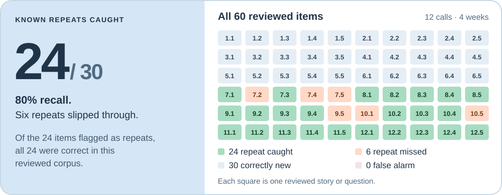

# Remi

Grandpa FaceTimes Remi whenever he likes. Remi remembers his stories, shows him family photos and
asks the questions his grandkids sent. His family gets the highlights, and a gentle note if how he
talks starts to change.

Built in 24 hours at HackPSU Fall 2026.

## Why

Older adults who live alone rarely want another app or a test, but they'll pick up a FaceTime call.
We borrowed the format from the I-CONECT study, where regular video chats with trained
interviewers went along with better scores for people with mild cognitive impairment. Whether an
AI gives the same benefit is untested.

## What the family sees

**Every chat, and what's next.** The newest chat, a gentle note when there is one, and a place to
add questions and photos for the next call.

**A recap of each chat.** What he talked about, the fun fact in his own words, the photos Remi
showed, and his answer to the family's question.

**How he sounded.** Pauses, pace, vague words and retold stories, each against his own usual.

During a call, the page updates live.

## How a call works

1. Hal FaceTimes Remi. Chert connects the call to our LiveKit agent.
2. The agent loads his context: last chat, stories, photos, the next family question.
3. They chat, using OpenAI's realtime voice model. Remi shows a photo and asks the question.
4. After he hangs up, we transcribe it, write the summary and fun facts, and compute speech markers.
5. A gentle note appears only if several markers stay off his usual for two weeks.

## What Remi isn't

- Not a medical device, and it doesn't diagnose anything. Changes in speech have everyday causes,
  and the note says so.
- No transcripts for the family, nothing shared until Hal says yes, and audio is deleted after
  analysis.
- The demo's four weeks of history are simulated, and labeled that way in the app.

## Can Remi recognize a story it has heard before?

**TL;DR:** In our human-reviewed test, Remi recognized **24 of 30 repeated stories or questions**
and **didn't mistake any of the 30 new items for a repeat**. It missed six repeats.

This matters because someone can tell the same story in different words. Matching it to an earlier
call helps Remi remember what has already been shared and gives the family a linked record of retellings.
A retelling can be intentional; recognizing one is not a judgment about someone's memory or health.

**What this measures:** repeat matching on 12 synthetic calls. Preliminary evidence, not an untouched holdout, a medical result, or a real-call performance estimate.

## Team

Stanley, Siyuan, Kevin, Ryan and Jimmy.
