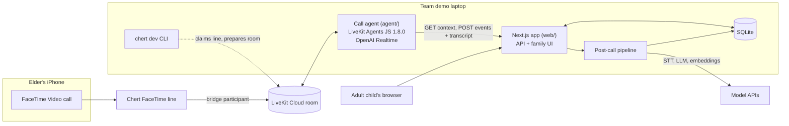

# Echo — Technical Specification

> **Working name.** Alternatives under discussion: LiaoLiao (聊聊, "let's chat"), KeepTalking. The name lives in exactly two places: `web/lib/config.ts` (`APP_NAME`) and the agent persona string in `agent/`. Rename there only.

| | |
|---|---|
| Event | HackPSU Fall 2026, ECoRE, Penn State |
| Hacking window | Sat Oct 24 2:00 PM ET → Sun Oct 25 1:45 PM ET |
| Hard deadlines | Devpost project created by **midnight Sat**; submission in place by **noon Sun** (table assignment); edits end 1:45 PM |
| Team operational target | **Stable submission at 11:30 AM Sunday** |
| Judging | Expo Sun 2:00–3:30 PM, ECoRE 202 |
| Doc version | 1.0 — Sat Oct 24 2026, ~9 PM ET |

**Tags used throughout:**
`[VERIFIED]` confirmed in Chert docs or by a logged team test ·
`[ASSUMED]` must be tested before anything depends on it ·
`[SIMULATED]` fake data; must be labeled as such in the UI, video, and pitch ·
`[HEURISTIC]` an engineering choice, not a clinical standard

---

## 0. Summary

Grandpa FaceTimes a friendly AI that knows his family's photos and remembers every story he has told. Each call is a warm 5–10 minute reminiscence conversation modeled on the I-CONECT trial format (a daily theme plus a picture prompt). After he hangs up, the system saves what he shared as "fun facts" for his kids, and compares interpretable speech markers (pace, pauses, filler and vague words, vocabulary diversity, stories retold across calls) against **his own** baseline. If several kinds of markers drift for several weeks, it gently tells the family it may be a good time for a check-up, with a link to the Alzheimer's Association warning signs. No app, no wearable, no test to take.

**Why it isn't a wrapper:** the value is longitudinal. Memory across calls, a per-person baseline, cross-session repetition detection, and a consented family loop. No single model call can do any of those.

**Two-sentence pitch:** Grandpa just FaceTimes a friendly AI that knows his family's photos and remembers every story he has told, inspired by a clinical trial where regular video conversations helped older adults' memory. Over weeks it notices changes in how he speaks and gently tells his kids when it may be time for a check-up, with no app, no wearable, and no test to take.

---

## 1. Goals, non-goals, and the claims policy

### 1.1 Priority tiers

**P0 — must work in the live demo**
1. Inbound FaceTime call through Chert reaches our LiveKit agent; two-way audio.
2. Agent greets the caller by preferred name *after* the caller says hello, and references the previous call (memory).
3. Agent asks one family-supplied question, naming who asked it.
4. Agent shows a family photo as its video while discussing it (fallback: static name card).
5. On hangup, transcript is saved; summary and at least one fun fact appear on the family timeline within ~30 s.
6. Markers for the new call are computed and plotted against a baseline built from `[SIMULATED]` four-week history.
7. Consent settings exist and are enforced server-side on what the family sees.
8. Nudge banner logic (shows on the drift scenario, absent on the stable one).
9. Seed / reset tooling and a recorded backup of a full call.

**P1 — strong additions**
Cross-session repeated-story detection · post-call audio capture with word timestamps (pause metrics) · verbal consent on first call · mood signal · Mandarin.

**P2 — stretch / roadmap only**
In-call reminders ("water the plants") · iMessage voice notes · gift ideas from things Grandpa mentions wanting · walk check-in · web call page (only if FaceTime fails go/no-go).

### 1.2 Non-goals this weekend
Training any classifier (DementiaBank needs approval; Pitt-trained models were shown to learn background-noise artifacts — arXiv 2406.07410). Diagnosis of anything. Outbound calls to the elder. Android or SMS. Avatars or a second participant in the room. Medication management. Real multi-week data. Reusing any code from the team's prior Brodie Coach / IvyHacks project (HackPSU requires original work started at 2 PM Saturday).

### 1.3 Claims policy (applies to code comments, prompts, UI copy, README, Devpost, video, and pitch)

| Never say | Say instead |
|---|---|
| Detects / diagnoses / screens for Alzheimer's or dementia | Notices changes in how someone talks over time, compared with their own usual |
| Prevents or slows decline | Inspired by research where regular video conversations helped older adults' cognition |
| Assesses depression / mental health from voice | Tracks mood words as a wellbeing note |
| "Accurate," "clinically validated" | Interpretable markers drawn from speech research; not validated as a product |
| Replaces doctors or caregivers | Nudges the family to talk to a doctor |
| Works on any phone | Works with FaceTime on iPhone/iPad/Mac |
| The agent calls Grandpa | Grandpa calls the agent (inbound only is documented) |

Full copy rules, the agent prompt, the consent script, and the crisis protocol live in `docs/safety-and-copy.md`.

---

## 2. Actors

| Actor | Interface | What they do |
|---|---|---|
| Elder ("Grandpa") | FaceTime only | Calls the line, talks, can say yes/no to sharing |
| Family member (adult child) | Web app | Sets up profile, photos, questions, proposed consent; reads timeline |
| Call agent | LiveKit room | Converses, shows photos, records consent/safety events, posts transcript |
| Operator (team, during demo) | Terminal + `/dev` page | Runs agent + Chert CLI, seeds/resets data |

---

## 3. End-to-end journeys

**3.1 Family setup (web).** Linda opens `/setup`, enters Dad's display name, preferred name ("Hal"), language, and a short "about" note; uploads ~3 photos with captions and who's in them; adds ~3 questions ("Ask Grandpa about his first car" — from Sam); proposes what may be shared (summaries, fun facts, speech trends, mood). The final screen shows the FaceTime address to save in Dad's contacts. Proposed sharing does nothing until Dad confirms it on a call.

**3.2 A call.** Hal FaceTimes the line. The agent joins the prepared room, loads Hal's context, and waits. Hal says "hello." The agent greets him by name and recalls last time ("Last week you told me about the roundhouse — did the snow ever let up?"). On the first call it asks his permission to share notes with family. It shows a family photo as its video and opens the day's theme, then asks Sam's question. It listens far more than it talks. Around minute 8–9 it winds down warmly and invites him to call again.

**3.3 After hangup (~10–30 s).** The agent posts the transcript. The server's pipeline transcribes captured audio with word timestamps (if available, then deletes the audio), extracts a summary, fun facts, topics, and mood, computes markers, checks for stories retold within 7 days, updates z-scores against Hal's baseline, and evaluates nudge rules. The family timeline (polling) shows the new call card, fun fact, and chart point.

**3.4 Over weeks.** Each call adds a point per marker. Baseline = Hal's first 6 adequate calls. If at least two marker *groups* drift in the concerning direction for two consecutive weeks, the family sees a gentle nudge with the Alzheimer's Association warning-signs link. A separate wellbeing nudge appears if mood reads low on several recent calls.

---

## 4. Architecture

| Component | Tech | Runs where | Owner |
|---|---|---|---|
| Call agent | Chert video starter (`chert new … --video`), `@livekit/agents` 1.8.0, OpenAI Realtime | Laptop (`npm start`) | Workstream A |
| Chert connector | `@trychert/facetime@0.1.0-beta.10` (`chert dev --agent NAME`) | Laptop, second terminal | A (human runs it) |
| API + DB | Next.js App Router (TS), Drizzle + better-sqlite3, zod | Laptop (`web/`) | Workstream B |
| Analysis pipeline + markers | TypeScript in `web/lib/analysis`, `web/lib/markers`; vitest | Inside the Next.js server process | Workstream C |
| Family app + seed + demo | Next.js pages, Tailwind, Recharts | Laptop (`web/`) | Workstream D |

**Topology for the demo:** one laptop runs the agent, `chert dev`, and `web/` with a local SQLite file. Agent ↔ web over `http://localhost:3000`. Judges view the timeline in a browser on the same or a second laptop on the LAN. Hosting is roadmap.

**Language decision:** keep whatever language the generated Chert video starter uses (the documented starter is ES-module JavaScript, `agent.mjs`). Do not migrate it to TypeScript this weekend. `web/` is TypeScript.

---

## 5. Chert + LiveKit facts

`[VERIFIED]` from docs.trychert.com (FaceTime CLI overview, video guide, build-agent guide), read Oct 24:

1. Install `npm install -g @trychert/facetime@0.1.0-beta.10`. macOS or Linux; Node **22.23.2 or 24.x**.
2. `chert new <name> --video` generates a starter that speaks and publishes an **animated face**; it does **not** consume the caller's camera (`AutoSubscribe.AUDIO_ONLY`, `videoEnabled: false`). `--video` selects starter code only; it does not enable video on a line.
3. `npm start` runs the agent and registers its dispatch name (`AGENT_NAME` → `ServerOptions.agentName`). `chert dev --agent NAME` must match that name **exactly**. The CLI does **not** start agent code; both terminals must stay running.
4. Starter env: `LIVEKIT_URL`, `LIVEKIT_API_KEY`, `LIVEKIT_API_SECRET`, `OPENAI_API_KEY`, `AGENT_NAME` in `.env.local`, loaded via `node --env-file`. Starter model: OpenAI Realtime `gpt-realtime`.
5. Chert may dispatch a job **before a caller exists** (prewarm/diagnostics). The starter connects promptly, `await ctx.waitForParticipant()`, then opens the model session. **No greeting on job start**; the caller speaks first because participant arrival does not prove FaceTime audio is ready.
6. Inbound FaceTime Audio and Video are supported. Outbound calls are **not documented**.
7. **Exactly one** agent audio publisher. Agent video must be published by **the same participant** that publishes the agent's audio, or FaceTime shows the line's default picture. Generic rooms allow **two participants** — no avatar sidecar.
8. The caller is the bridge participant `chert-bridge-<call ID>`, with tracks `facetime-remote-audio` and `facetime-remote-video`. Warm-room job metadata has **no call media or call ID**.
9. After hangup the CLI removes the room and prepares a fresh one. Ctrl+C releases the line.
10. A waiting agent does not prove working media. Required live checks: two-way speech, changing agent video, caller hangup, room cleanup, a fresh second call.

`[ASSUMED]` until tested: the team's line is video-enabled; caller handle (phone/Apple ID) is not exposed to the agent, so **one line = one elder** for the demo (`ELDER_ID` env); a second parallel `AudioStream` on the caller's audio track works for capture; the agent leaving the room ends the FaceTime call cleanly.

---

## 6. Call agent

### 6.1 Lifecycle
1. Job dispatched → `ctx.connect()` promptly (subscribe to audio; video subscription not needed).
2. Start publishing the agent's video track immediately with the default card (name + soft background), so FaceTime never shows a stale frame.
3. `await ctx.waitForParticipant()`; record `bridgeIdentity` (parse call ID from `chert-bridge-<id>` if present).
4. `GET /api/agent/context?elderId=…` (1.5 s timeout). On failure use a minimal fallback context (no memory, generic warm persona) — never crash the call.
5. `POST /api/agent/calls` → `callId`.
6. Build instructions from context (template in `docs/safety-and-copy.md`) and start `voice.AgentSession` with Realtime model, tools, and tuned turn detection. `record: false`.
7. Wait for the caller to speak first, then greet by preferred name with one memory callback.
8. During the call: collect transcript items with timestamps; tools post events (`photo_shown`, `question_asked`, `consent`, `safety`).
9. Optional (`CAPTURE_AUDIO=1`): write the caller's audio to `tmp/calls/<callId>.wav` (16 kHz mono).
10. On caller disconnect / shutdown callback: `POST /api/agent/calls/:id/complete` with the full utterance list and `audioPath` (3 s timeout, retry once, then write the payload to `tmp/failed/<callId>.json` for manual replay). Close the session.

### 6.2 Conversation design (I-CONECT-inspired)
Order: greeting with memory → first-call consent (if not yet confirmed) → today's theme with a photo → the family question (once, crediting the asker) → follow-ups on whatever he enjoys → at ~8 min, wind down → warm close ("I'd love to hear more next time — call me anytime").

Rules: one question at a time; one or two short sentences per turn; never quiz or test memory; never correct his memories; if he retells a story, enjoy it and ask a new detail — **never** say "you told me that already"; never mention speech analysis or dementia; says plainly it's an AI if asked; no medical, legal, or financial advice. `DEMO_MODE=1` compresses the flow: memory greeting, then photo + family question within the first two agent turns.

### 6.3 Tools (function calling)
| Tool | Args | Effect | Must return within |
|---|---|---|---|
| `show_photo` | `photoId` | Switch published video to that photo with caption; POST `photo_shown` | 200 ms (render async) |
| `mark_family_question_asked` | `questionId` | POST `question_asked` | 200 ms |
| `record_consent` | `summaries`, `funFacts`, `speechTrends`, `mood` (booleans, any subset) | POST `consent` | 200 ms |
| `report_safety_concern` | `category` (`self_harm` \| `medical_emergency` \| `other`), `note` | POST `safety`; agent follows crisis script | 200 ms |

Tools fire-and-forget their HTTP calls so the model never waits on the network.

### 6.4 Agent video
Replace the starter's animated-face frame source with an image renderer: decode the photo, letterbox into the starter's existing frame size, composite a caption strip (e.g. "Dad at the Altoona shops, 1971"), and push frames at the starter's existing rate (or ~5–10 fps for static images). Default card when no photo is active. Same participant as the audio — do not create a second participant.

### 6.5 Turn-taking and latency
Older adults pause longer mid-thought; being interrupted ruins the conversation **and** corrupts pause markers. Raise the end-of-turn silence threshold to roughly 900–1200 ms `[HEURISTIC]`, tune by ear. Targets: agent audio begins < 1.5 s after the caller stops; no barge-in during the caller's mid-sentence pauses. Log per-turn latency to the console.

### 6.6 Language
`elder.language` ∈ {`en`, `zh`}. The instructions say which language to speak; the Realtime model handles Mandarin. English first; Mandarin only after the P0 loop passes ten consecutive runs. Family-facing summaries are English by default; fun facts keep the original-language quote plus an English rendering.

### 6.7 Transcript and audio capture
Primary transcript: conversation items from the session (caller items need Realtime input transcription enabled — verify config in the installed package). Store each item with `startMs`/`endMs` relative to call start (approximate from VAD/turn events if exact times aren't exposed). Word-level timing comes from **post-call** STT on the captured WAV (`CAPTURE_AUDIO=1`), which also gives pause metrics. If capture destabilizes the call, turn it off: markers degrade gracefully (pause metrics become `na`).

### 6.8 Failure modes
| Failure | Behavior |
|---|---|
| Context API down | Generic warm persona, no memory; still posts transcript later if API returns |
| Photo fetch/render fails | Stay on default card; conversation continues |
| Tool HTTP fails | Log; never surface to the caller |
| Caller hangs up abruptly | Shutdown callback still posts transcript |
| Complete POST fails | Save JSON to `tmp/failed/`; `scripts/replay-failed.mjs` resends |
| Model session error | Speak a short apology if possible; end gracefully |

---

## 7. Data model (summary)

SQLite, one file at `web/data/echo.db` (gitignored). Full DDL and types in `docs/contracts.md`.

`elders` · `family_members` · `photos` · `family_questions` · `consents` (family-proposed + elder-confirmed per category) · `themes` · `calls` (status, utterances JSON, summary, mood, `is_simulated`) · `call_events` · `fun_facts` · `topics` (story/question, initiated_by, embedding, `repeat_of_topic_id`) · `call_markers` (value, unit, z, confidence) · `baselines` · `nudges` · `safety_events`.

Every table that can hold demo data has `is_simulated`.

---

## 8. API (summary)

Agent-facing (`Authorization: Bearer $AGENT_API_TOKEN`): `GET /api/agent/context`, `POST /api/agent/calls`, `POST /api/agent/calls/:id/events`, `POST /api/agent/calls/:id/complete`, `GET /api/agent/photos/:id`.

Family-facing: elders CRUD, photo upload/delete, questions, consent, `GET /api/elders/:id/timeline`, nudge dismiss.

Dev (`DEV_TOOLS=1` only): seed (`drift` | `stable`), reset, re-run pipeline for a call.

Full shapes and examples: `docs/contracts.md`. **That file is the source of truth** for all cross-workstream interfaces.

---

## 9. Post-call pipeline

Triggered by `/complete` (in-process async job; status tracked on the `calls` row). Every step is idempotent; re-runnable via the dev endpoint.

1. **STT (if `audioPath`)**: transcribe with word timestamps using a provider that keeps disfluencies (fillers are often stripped by default — verify the provider's option). Replace caller utterances' `words`. **Delete the WAV in a `finally` block.**
2. **LLM extraction** (one call, JSON validated with zod, one retry): family-facing summary (3–5 warm sentences, no clinical language); `funFacts[]` (text, quote, optional `questionId`); `topics[]` (kind, short summary, `initiatedBy`); `mood` (label, score −1..1, evidence quotes); `familyQuestionAnswers`.
3. **Markers**: deterministic functions over caller utterances (section 10).
4. **Repetition**: embed caller-initiated story topics; match against caller-initiated stories from *other* calls in the prior 7 days.
5. **Baseline + z-scores**: create the baseline when the 6th adequate call lands; compute robust z for every later call.
6. **Nudges**: evaluate rules (section 11); insert at most one active nudge per type.
7. Mark `done` (or `failed` with `failed_step` and `error`).

Provider choice: post-call LLM may be Gemini (MLH "Best Use of Gemini API") or OpenAI, behind `web/lib/analysis/llm.ts` with `LLM_PROVIDER`. Embeddings behind the same adapter.

---

## 10. Speech markers (summary)

Full definitions, word lists, units, edge cases, and test vectors: `docs/markers.md`.

| Key | What it measures | Concern direction | Group | Needs word timestamps |
|---|---|---|---|---|
| `speech_rate` | words/min (en) or Han chars/min (zh) while speaking | down | pace | best with; approximated without |
| `pause_rate` | within-turn pauses ≥ 400 ms per 100 words | up | pauses | yes |
| `mean_pause_ms` | mean length of those pauses | up | pauses | yes |
| `wfp_rate` | word-finding pauses (≥ 1 s next to a filler/vague word) per 100 words | up | pauses | yes |
| `filler_rate` | um/uh/嗯/呃… per 100 words (per 100 chars zh) | up | words | no |
| `vague_rate` | thing/stuff/那个/东西… per 100 words | up | words | no |
| `mattr` | moving-average type-token ratio, window 50 | down | words | no |
| `repeat_stories` | caller-initiated stories retold from another call in prior 7 days | up | repetition | no |

Calls with fewer than 100 caller words (en) or 150 Han characters (zh) are `confidence: low`: plotted hollow, excluded from baseline and drift.

---

## 11. Nudge logic `[HEURISTIC]`

- **Baseline:** the elder's first 6 adequate calls, per marker, per language: median and MAD. Robust z = (x − median) / scale, where scale = max(1.4826 × MAD, 3% of |median|, 1e-6). Stored signed so positive = concerning.
- **Weekly score:** per ISO week, median z of the week's adequate calls, signed so positive = concerning.
- **Group drifts in a week** if any of its markers has weekly z ≥ 1.5; the repetition group drifts if the week's summed `repeat_stories` ≥ 3.
- **Cognitive check-up nudge:** ≥ 2 groups drifting in each of 2 consecutive weeks, and ≥ 8 total adequate calls on record.
- **Wellbeing nudge:** mood label `low` on ≥ 3 of the last 5 calls.
- Nudges respect consent (`speechTrends` / `mood`). One active nudge per type; dismissed nudges can re-fire after 14 days.
- Thresholds live in `web/lib/analysis/config.ts`; do not scatter magic numbers.

Copy templates (with the "not a diagnosis; many things cause changes" caveat and the Alzheimer's Association link) are in `docs/safety-and-copy.md`.

---

## 12. Consent, privacy, safety

- **Two-key consent:** the family *proposes* categories; the elder *confirms* on a call via `record_consent`. Effective sharing = proposed AND confirmed, per category. Before confirmation, the family sees only that a call happened and its length.
- The elder is told honestly that the service keeps track of how the chats go over time (e.g., talking speed) to let family know about changes. No covert analysis.
- The family never sees raw transcripts — only summaries, fun facts, trend charts, and nudges, each gated by consent. Enforced **server-side** in the timeline endpoint.
- Raw audio is deleted after processing. Secrets never committed; `.env*` gitignored.
- **Crisis protocol:** if the caller describes a medical emergency, the agent tells him to hang up and call 911. If he talks about wanting to die or harming himself, the agent responds with care, gives 988 (Suicide & Crisis Lifeline; call or text) and 911 for immediate danger, encourages reaching out to family, calls `report_safety_concern`, and stops the reminiscence agenda. Safety events are logged for the operator; automatic family alerting is roadmap pending proper review.
- Mood is a wellbeing note, never a mental-health assessment; a mood change is a reason for a check-in, not a dementia flag (depression can mimic dementia).

---

## 13. Family web app

| Route | Purpose |
|---|---|
| `/` | Choose elder (or "Set up a new profile") |
| `/setup` | 5-step wizard: basics → photos → questions → proposed sharing → done (FaceTime address + "save as contact" tip) |
| `/elders/[id]` | Timeline: nudge banner, call cards (summary, photo discussed, family question + answer), fun facts, trends, repeated stories |
| `/elders/[id]/manage` | Add photos/questions; edit proposed sharing |
| `/dev` | `DEV_TOOLS=1` only: seed drift/stable, reset, re-run pipeline, show last pipeline errors |

Design: warm, large type, high contrast, works on a phone. Every simulated item carries a visible "Simulated" badge; charts draw simulated points in a distinct style plus a legend. Each marker chart has a one-line plain-language "what this is" and the standing disclaimer. Timeline polls every 3 s while any call is `processing`, otherwise every 15 s.

---

## 14. Demo plan (summary)

Persona: **Harold "Hal" Bennett**, 81, retired railroad mechanic from Altoona, Army veteran, lives alone; daughter **Linda** set it up; grandson **Sam** is at Penn State. `[SIMULATED]` 12 calls over 4 weeks (drift scenario: weeks 3–4 drift in pace, pauses, and vague words, plus one story retold). Live: a judge FaceTimes the line as Grandpa; the agent recalls a simulated earlier call, shows a photo, asks Sam's question; after hangup the timeline updates. Say plainly which parts are simulated. Recorded backup ready. Full script, seed spec, operator checklist, and 5-minute video outline: `docs/demo.md`.

---

## 15. Testing and acceptance

| Level | What | Owner |
|---|---|---|
| Unit | Markers: test vectors in `docs/markers.md`; baseline/drift with synthetic series; consent filter | C, B |
| Contract | `scripts/smoke.sh` curls every endpoint with fixture payloads | B |
| Pipeline | Replay `fixtures/transcripts/*.json` through `/complete`; timeline shows summary < 30 s | C |
| Agent offline | `MOCK_CONTEXT=1` and a fake API; instructions render correctly for en/zh/first-call | A |
| Live (human) | Chert checklist: two-way speech, agent video changes on `show_photo`, hangup, cleanup, fresh second call; memory recall across two consecutive calls; family question asked once; consent recorded | A + human |
| End-to-end | Full demo loop ×10 from reset; log latency and failures in `docs/HANDOFF.md` | All |

---

## 16. Build timeline and owners

| Time (ET) | A — Call agent | B — Backend | C — Analysis | D — App + demo |
|---|---|---|---|---|
| 8:30–9:30 PM | **Go/no-go:** FaceTime hello-world with video starter | Scaffold `web/`, DB schema, migrations | Markers lib + tests | Setup wizard against fixtures |
| 9:30 PM–12 AM | Context load, transcript POST, memory greeting | All contract endpoints, smoke tests | LLM extraction, pipeline runner | Timeline skeleton; **GitHub public + Devpost created before midnight** |
| 12–3 AM | Photo video + `show_photo`; family question; consent | Consent filter, photo serving | Repetition, baseline, nudges | Seed script (drift/stable), trends chart |
| 3–7 AM | Turn-taking tuning; audio capture; Mandarin (if P0 stable) | Hardening, replay tool | STT adapter with word timestamps | Polish, badges, `/dev`; sleep in shifts |
| 7–10 AM | Full loop ×10, fix latency | ← all → | ← all → | Record backup demo |
| 10–11:30 AM | Freeze features | | | 5-min video, Devpost, rehearse |
| **11:30 AM** | **Submit stable version** | | | |
| 11:30 AM–1:45 PM | Bug fixes only; no new features | | | |

Human mapping (3 engineers): Engineer 1 → A; Engineer 2 → B + C; Engineer 3 → D (+ pitch).

---

## 17. Risks and fallbacks

| Risk | Signal | Fallback |
|---|---|---|
| Chert FaceTime doesn't work with our credentials | Go/no-go fails at 9:30 PM | Same agent via a LiveKit web call page; pitch keeps "FaceTime" as the target channel, honestly labeled |
| Line not video-enabled | Audio works, default picture shows | Audio-only demo; show photos on the family timeline instead |
| Realtime latency too high | > 2 s responses | Shorten instructions, trim context, check region; keep calls short in demo |
| Agent interrupts | Cuts off mid-thought | Raise silence threshold |
| Audio capture breaks the session | Errors/glitches with capture on | `CAPTURE_AUDIO=0`; pause markers show "not available" |
| Pipeline LLM output invalid | zod failures | Retry once; then summary-only fallback; never block the timeline |
| Wi-Fi at the expo | Dropouts | Phone hotspot for the laptop; recorded backup |
| Judge questions health claims | — | Claims policy; cite I-CONECT honestly (human interviewers, Phase II, 186 people) |
| Scope creep | New features after 3 AM | Feature freeze at 10 AM; P2 stays roadmap |

---

## 18. Judging criteria mapping

| Criterion | Our evidence |
|---|---|
| Implementation | Live FaceTime call → timeline update in front of the judge |
| Clarity | One user (Hal), one loop (call → family timeline), one honest claim |
| Creativity (beyond a wrapper) | Longitudinal memory, per-person baselines, cross-call repetition detection, two-key consent |
| Growth | Chert + LiveKit realtime voice/video, speech-marker engineering, Mandarin |
| Impact | 7.4M Americans 65+ with Alzheimer's (2026); ~13M unpaid caregivers; underdiagnosis (~56% undiagnosed in CFAS II; people living alone less likely diagnosed); treatment eligibility depends on early stage |

---

## 19. Open questions (owner → answer in `docs/HANDOFF.md`)

1. Is our assigned Chert line video-enabled? (A, at go/no-go)
2. Can the agent read the caller's handle? If yes, map callers to elders. (A)
3. Does a parallel caller-audio stream work alongside the Realtime session? (A)
4. Exact Realtime input-transcription and turn-detection options in `@livekit/agents` 1.8.0. (A — read `node_modules` types)
5. STT provider that keeps fillers with word timestamps, and its Mandarin behavior. (C)
6. Is the team eligible to enter Grand + a sponsor/MLH prize simultaneously? (D — ask organizers)
7. Final product name. (Team)

---

## 20. Sources for pitch and Devpost

- Alzheimer's Association, 2026 Facts and Figures — https://www.alz.org/alzheimers-dementia/facts-figures
- Alzheimer's Association stages — alz.org/alzheimers-dementia/stages
- I-CONECT RCT (NCT02871921): Dodge et al., *The Gerontologist* 2024, doi 10.1093/geront/gnad147 — https://pmc.ncbi.nlm.nih.gov/articles/PMC10943511
- 2024 Lancet Commission: 14 modifiable risk factors incl. social isolation and physical inactivity
- Boston University / Framingham speech model, *Alzheimer's & Dementia* June 2024 — https://www.bu.edu/hic/2024/06/25/the-brink-boston-university-ai-method-early-prediction-alzeimers
- Clever Hans effect in DementiaBank models — https://arxiv.org/pdf/2406.07410
- Erickson et al., PNAS 2011 (aerobic walking, hippocampal volume) — https://experts.illinois.edu/en/publications/exercise-training-increases-size-of-hippocampus-and-improves-memo/
- Chert FaceTime CLI docs — https://docs.trychert.com/facetime-cli/overview
- Competitors: Canary Speech, Winterlight Labs (clinical speech biomarkers). Our difference: lives in FaceTime, family photos and questions, memory across calls, family loop.
